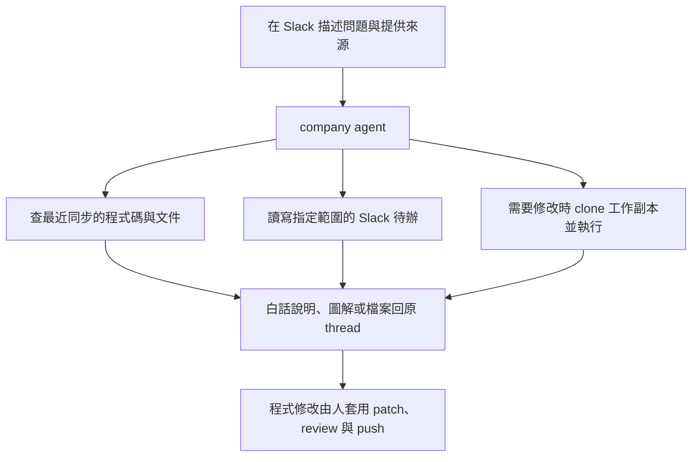
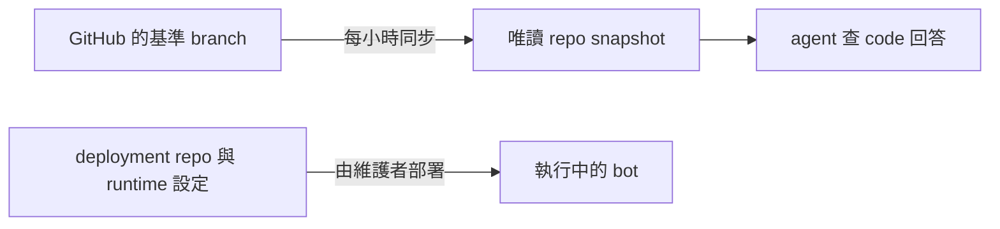

# 使用 Slack 公司助理

直接 DM 助理，或在 channel @ 它，後續留在同一個 thread。不必先安裝工具或記住 skill 名稱。

Slack 是對話入口，OpenAB 經由 codex-acp 啟動 Codex 執行工作。你可以請它讀寫檔案、執行指令、使用工具與 skills，從理解問題一路做到製作與驗證；不必把需求限制在 Home 列出的範例。實際能完成哪些工作，取決於 container 裡的工具、連線、權限與這個 bot 的規則，需要額外資料或存取權時會說明。

Codex 的通用能力見[官方 CLI 介紹](https://developers.openai.com/codex/cli/)；這個部署的設定與限制見[系統設計](system-design.md)。

## 從問題到回覆

以下只是常見用法，不是完整能力清單；也可以直接描述其他目標。

| 想做什麼 | 可以這樣問 |
|---|---|
| 查產品行為 | 「這個操作在什麼條件下會被擋住？請查 code 說明。」 |
| 看懂流程 | 「用 show-me 圖解這段流程，標出還缺哪些資訊。」 |
| 釐清需求 | 「需求還不清楚，先問我問題。」 |
| 查待辦 | 「我還有哪些待辦？PM 有沒有回覆？」 |
| 驗畫面 | 「把首頁跑起來，照這三條條件點一遍，附截圖。」 |
| 修改程式 | 「把登入錯誤訊息改成中文，驗證後給我 patch。」 |
| 了解 bot | 「讀 agent-company，說明你怎麼同步 repo、有哪些限制，附來源版本。」 |

可查閱的 repo 以 Slack Home 與 [snapshot 設定](../config/repos.conf)為準。

## 圖解在哪裡看

Slack Home 用文字箭頭和簡短說明，方便在手機上閱讀。Slack 不渲染 Mermaid；在對話裡要求圖解時，可用文字樹、箭頭，或請助理提供 PNG。GitHub 上的 README 與本指南則使用 Mermaid 呈現流程。

## 程式碼版本與實際部署

Snapshot 是最近同步成功的程式碼，未必等於正式環境。新增 snapshot 不會自動重新部署產品或 bot。

`agent-company` 是這個 bot 的部署 repo。它的 snapshot 可用來解釋設定、設計與限制；回答應標出使用的 branch 與 commit。只讀 code 無法確認當下 container、環境變數或外部服務的狀態，需要維護者另行驗證。未 commit／push 的修改也不會出現在從 GitHub 同步的 snapshot。

前端 code 可協助查操作條件與 API 呼叫；後端與正式環境資料仍需其他證據。專案管理平台的 snapshot 可解釋平台如何運作，直接讀寫即時專案資料則需要另接 API／MCP。

## Skills 與原作者教學

Slack Home 保留常用能力與提問範例；[完整 skill 清單與內容](https://github.com/henry5720/agent-config/tree/main/skills)在 agent-config，由 Skillshare 同步到 bot。GitHub 清單可能比 bot 最近同步的版本更新。Skills 提供做事的方法，Home 的例子也不涵蓋所有用途；實際執行仍取決於環境的工具、連線、權限與 bot 規則。

| 來源 | 適合閱讀的內容 |
|---|---|
| [Matt Pocock／AI Hero](https://www.aihero.dev/) | coding agent 工作方法與 skills 教學，偏工程實務 |
| [show-me 原作者介紹](https://www.humanlayer.com/blog/show-me-skill) | 用簡短圖解理解流程與程式結構的範例 |
| [Skillshare](https://skillshare.runkids.cc/) | 想在自己電腦管理、同步 skills 與 MCP 時閱讀 |
| [Herdr](https://herdr.dev/) | 想管理本機或遠端 coding agent 時閱讀 |

使用 Slack 助理不需要先安裝 Skillshare 或 Herdr。通用教學由原作者維護；本 repo 只記公司助理的使用方式與限制。

部署與維護步驟見 [runbook](runbook.md)，信任邊界見[系統設計](system-design.md)。
