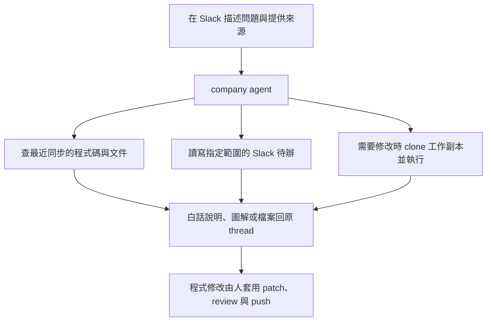
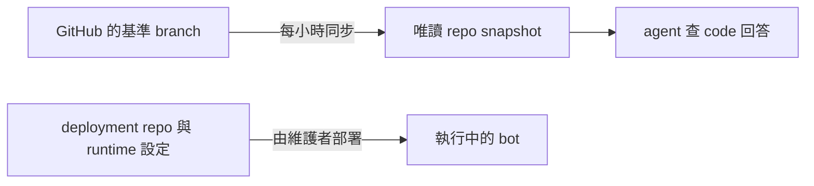

# 使用 Slack 公司助理

直接 DM 助理，或在 channel @ 它，後續留在同一個 thread。不必先安裝工具或記住 skill 名稱。

Slack 是對話入口，OpenAB 經由 codex-acp 啟動 Codex 執行工作。你可以請它讀寫檔案、執行指令、使用工具與 skills，從理解問題一路做到製作與驗證；不必把需求限制在 Home 列出的範例。實際能完成哪些工作，取決於 container 裡的工具、連線、權限與這個 bot 的規則，需要額外資料或存取權時會說明。

Codex 的通用能力見[官方 CLI 介紹](https://developers.openai.com/codex/cli/)；這個部署的設定與限制見[系統設計](system-design.md)。

## 從問題到回覆

以下只是常見用法，不是完整能力清單；也可以直接描述其他目標。

| 想做什麼 | 可以這樣問 |
|---|---|
| 查產品行為 | 「這個操作在什麼條件下會被擋住？請查 code 說明。」 |
| 看懂流程 | 「用 show-me 圖解這段流程，標出還缺哪些資訊。」 |
| 釐清需求 | 「需求還不清楚，先問我問題。」 |
| 查待辦 | 「我還有哪些待辦？PM 有沒有回覆？」 |
| 驗畫面 | 「把首頁跑起來，照這三條條件點一遍，附截圖。」 |
| 修改程式 | 「把登入錯誤訊息改成中文，驗證後給我 patch。」 |
| 了解 bot | 「讀 agent-company，說明你怎麼同步 repo、有哪些限制，附來源版本。」 |

可查閱的 repo 以 Slack Home 與 [snapshot 設定](../config/repos.conf)為準。

## 圖解在哪裡看

Slack Home 用文字箭頭和簡短說明，方便在手機上閱讀。Slack 不渲染 Mermaid；在對話裡要求圖解時，可用文字樹、箭頭，或請助理提供 PNG。GitHub 上的 README 與本指南則使用 Mermaid 呈現流程。

## 程式碼版本與實際部署

Snapshot 是最近同步成功的程式碼，未必等於正式環境。新增 snapshot 不會自動重新部署產品或 bot。

`agent-company` 是這個 bot 的部署 repo。它的 snapshot 可用來解釋設定、設計與限制；回答應標出使用的 branch 與 commit。只讀 code 無法確認當下 container、環境變數或外部服務的狀態，需要維護者另行驗證。未 commit／push 的修改也不會出現在從 GitHub 同步的 snapshot。

前端 code 可協助查操作條件與 API 呼叫；後端與正式環境資料仍需其他證據。專案管理平台的 snapshot 可解釋平台如何運作，直接讀寫即時專案資料則需要另接 API／MCP。

## 接你自己的瀏覽器

助理平常用自己的 headless Chrome，結果截圖回 thread。網站要你登入、你想看著它做或中途接手時，可以請它接你自己的 Chrome。

**在 DM 叫它**，例如「幫我接我的瀏覽器，到後台把這筆訂單的狀態查出來」。在 channel 提出時，它會請你改到 DM：它回給你的 connect 網址就是鑰匙，拿到的人能操作那支 Chrome，DM 的 thread 只有你看得到。

它會回三步，照做就接上：

1. 安裝 cloudflared（第一次才要），依你的 OS 從 Cloudflare 官方下載頁選；
2. 開一個新的終端機，貼上它給的那一行（hostname 已填好），開著別關；
3. 在裝了 [Playwright Extension](https://github.com/henry5720/dotfiles/blob/main/docs/remote-access/browser.md#插件獨立-profile日常-profile-都能裝) 的 Chrome 開新分頁，貼上 connect 網址，在插件畫面選分頁、按允許。

要在約 5 分鐘內做完，逾時它會收掉，再叫一次就好（網址每次不同）。每一步在做什麼、卡住怎麼查，見 [browser.md 的〈tailnet 外：一次性 tunnel〉](https://github.com/henry5720/dotfiles/blob/main/docs/remote-access/browser.md#tailnet-外一次性-tunnel)；卡住時把終端機印出的錯誤和你的 OS 貼給它，它會針對教你。

接上之後它開新分頁做事，不蓋掉你正在看的那頁；每一步你都看得到，要輸入密碼或核准時直接接手。用完它會 detach、收掉 tunnel，網址立刻失效，Chrome 和分頁留著。

**建議裝在獨立 profile**：在 Chrome 另開一個 profile 只裝這個插件、只登入這次要用的網站。插件接上期間，助理用的是這個 profile 裡所有的登入；日常 profile 裡有你的信箱、公司帳號和各種登入，獨立 profile 只交出你願意交的那幾個。一定要日常 profile 裡的東西（passkey、硬體金鑰、裝置 SSO）時，裝在日常 profile 也可以，由你決定，見 [browser.md 的〈插件〉](https://github.com/henry5720/dotfiles/blob/main/docs/remote-access/browser.md#插件獨立-profile日常-profile-都能裝)。

**接上之後，這個 thread 裡任何人叫助理做事，用的都是你的瀏覽器。** 助理所有對話共用同一個工作區，別的對話也叫得到這條連線。這裡不另加限制：接著的時候看著它做，用完就請它 detach。

## 讓它操作你的 Windows 桌面 app

要助理操作你 Windows 上的桌面 app（截圖、點擊、打字），你在自己的 Windows 起 Windows-MCP，開一個公開網址，把網址和 key 交給它。

**在 DM 叫它**，例如「我要讓你操作我 Windows 上的 ERP，幫我把這張單的欄位填一遍」。在 channel 提出時，它會請你改到 DM：網址加 key 等於你桌面的控制權，DM 的 thread 只有你看得到。

你要做的事，照 [windows-mcp 給人看的說明](https://github.com/henry5720/agent-config/blob/main/docs/skills/windows-mcp.md)走 quick tunnel 那條：

1. 第一次先[裝 Windows-MCP 和 cloudflared](https://github.com/henry5720/agent-config/blob/main/docs/skills/windows-mcp.md#第一次在那台裝-windows-mcp)；
2. 照[〈quick tunnel：你要貼的〉](https://github.com/henry5720/agent-config/blob/main/docs/skills/windows-mcp.md#quick-tunnel你要貼的)起 server、換 key，再貼助理給你的那行 quick tunnel 指令，開著別關；
3. 在 DM 交兩樣東西：`https://<隨機>.trycloudflare.com` 那個網址，和剪貼簿裡的 key。

它會先確認網址不帶 key 被擋、帶 key 接得上，再截一張桌面圖回 thread，讓你確認接到的是你那台。接著照你的要求操作；要輸入帳密或驗證碼時它會停下來，由你自己在那台輸入。

**用完一定收掉、換 key。** 跟它說「收掉」，它會先斷線；你照[〈quick tunnel：用完收掉〉](https://github.com/henry5720/agent-config/blob/main/docs/skills/windows-mcp.md#quick-tunnel用完收掉)在那台貼上，停掉 tunnel 和 server、換一把新 key，它再從它那邊確認網址連不上（Cloudflare 回 `530`）。key 是在對話裡交的，會留在 DM 和助理的工作紀錄裡，所以每次都換，下次再起 server 用的是新 key。

**接上期間，助理看得到、也操作得到你整個桌面**：畫面上開著的信箱、聊天、文件都會被截圖拍進去，它也能開 PowerShell。助理所有對話共用同一個工作區，這段期間別的 thread 叫它做事，也接得到你的桌面。這裡不另加限制：開之前關掉不想給它看的視窗，接著的時候看著它做，用完就收。

## Skills 與原作者教學

Slack Home 保留常用能力與提問範例；[完整 skill 清單與內容](https://github.com/henry5720/agent-config/tree/main/skills)在 agent-config，由 Skillshare 同步到 bot。GitHub 清單可能比 bot 最近同步的版本更新。Skills 提供做事的方法，Home 的例子也不涵蓋所有用途；實際執行仍取決於環境的工具、連線、權限與 bot 規則。

| 來源 | 適合閱讀的內容 |
|---|---|
| [Matt Pocock／AI Hero](https://www.aihero.dev/) | coding agent 工作方法與 skills 教學，偏工程實務 |
| [show-me 原作者介紹](https://www.humanlayer.com/blog/show-me-skill) | 用簡短圖解理解流程與程式結構的範例 |
| [Skillshare](https://skillshare.runkids.cc/) | 想在自己電腦管理、同步 skills 與 MCP 時閱讀 |
| [Herdr](https://herdr.dev/) | 想管理本機或遠端 coding agent 時閱讀 |

使用 Slack 助理不需要先安裝 Skillshare 或 Herdr。通用教學由原作者維護；本 repo 只記公司助理的使用方式與限制。

部署與維護步驟見 [runbook](runbook.md)，信任邊界見[系統設計](system-design.md)。
